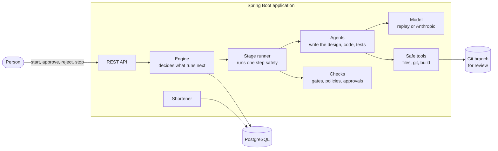
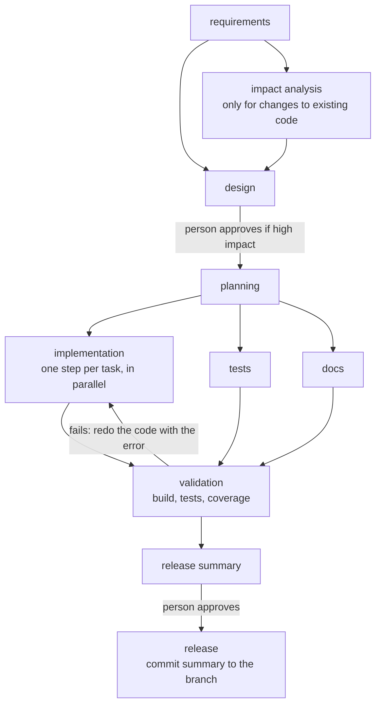

# Architecture

## The big picture

This is **one Spring Boot application with one PostgreSQL database**. Inside it are two separate parts:

| Part | What it does |
| --- | --- |
| **Shortener** (`com.agentic.shortener`) | The product. Creates short links, redirects visitors, and counts clicks. |
| **Orchestrator** (`com.agentic.orchestrator`) | A workflow engine. You give it a requirement ("let users set a custom expiry on their links") and it works through the steps of building it: design, code, tests, docs, checks. The result is a **git branch** for a person to review. |

The two parts never call each other. The orchestrator only works on a **separate copy of the source code** (a git worktree on its own branch), and a test fails the build if either part starts depending on the other. The orchestrator **never merges or pushes**: a human decides what happens to the branch.

## How a run works

The steps are listed in `workflows/sdlc.yaml`, each with what it depends on. A step starts as soon as everything it depends on is done, so independent steps run **at the same time**.

A few things worth knowing:

- **Planning creates the implementation steps.** The plan lists tasks; each task becomes its own step. Validation waits for all of them.
- **Impact analysis is skipped for brand-new features.** A skipped step counts as done.
- **A step can run again.** If validation fails, a person rejects a design, or an earlier output changes, only the affected steps are redone.
- **Every change of state is saved to the database**, so a run survives a restart.

### What happens inside one step

1. **Check it may start:** everything it depends on is finished, and there is token budget left.
2. **Run the agent.** The agent proposes something (a design, a patch, ...).
3. **Run the checks (gates)** on what it proposed: is the format valid, does it stay within the approved design, does it break a policy?
4. **Ask a person if it is high impact** (see below). If so, the output waits, **unapplied**, until they decide.
5. **Accept it:** save the output, apply the patch to the branch and commit it.

If a check fails, the problems are fed back to the agent and it tries again. After a few failed attempts a **fallback** takes over (for example, a template writes the docs instead of the model). If that fails too, the step and the run fail.

## Keeping it safe

The rule is: **the model only proposes; ordinary code decides.** Everything below is plain, tested code that the model cannot talk its way around.

**People approve risky changes.** A person must approve a change that adds a database migration, changes the public API, touches security-related files, adds a dependency, deletes files, is very large, or is the final release. An approval or rejection needs a comment. A rejection becomes an instruction for the next attempt. These decisions need the `X-Approval-Key` header.

**Policies block unsafe patches before anything is written:**

| Rule | Examples |
| --- | --- |
| Security | no secrets in code, no starting processes, no SQL built by string concatenation, new dependencies only from an allowed list |
| Privacy | never store raw IP addresses |
| Change control | existing database migrations cannot be edited, the orchestrator's own code is off limits, every changed class needs a test, a change may only touch files the approved design lists |

**The tools are sandboxed.** Agents can only read and write inside their own workspace (no `..`, no absolute paths, no symlink escapes, no `.git`). Git is limited to a short list of commands, so there is no push, fetch or merge. There is no general "run a command" tool at all.

**Limits keep runs bounded.** Retries, rejections and clarification rounds all have caps. A **safe-stop** pauses a run without losing anything. It can be requested by a person, or happens automatically when the token budget runs out, policy violations pile up, or the model fails 5 times in a row. A budget stop can only be resumed with a bigger budget.

## When things go wrong

- **A build fails.** Validation reopens the code steps that the failure points to, passing the build error as feedback. If only test files are named, the implementation steps are reopened too.
- **Rollback.** Each accepted patch is stored. To roll back, the engine rebuilds the workspace from the starting point, replaying only the patches that stay. Steps that were not affected are **not redone**. The cost: the branch history is rewritten, which is fine before review.
- **Something upstream changes.** Each step remembers a fingerprint of its inputs. When an earlier output changes, only steps whose inputs really changed are redone. If the regenerated output is identical, nothing downstream reruns.
- **Not enough information.** If the requirement is too vague, the run **pauses and asks questions**, each with a proposed answer. A person answers (or accepts the proposals) and the plan is redone.
- **The app crashes.** Steps that were mid-way go back to "waiting" and the run continues after restart.

## What gets recorded

- **Artifacts:** every accepted output, saved with a fingerprint.
- **Decisions:** who decided what and why (agent, engine, or a named person). `GET /api/v1/runs/{id}/decisions`
- **Audit trail:** an append-only log where each entry includes a hash of the one before it, so editing or deleting a row is detectable. `GET /api/v1/audit/verify` checks the whole chain.
- **Reliability metrics:** success rates, retries, fallbacks, rollbacks, how long failures take to recover from, and latencies. `GET /api/v1/metrics/reliability`

## The model

The orchestrator talks to the model through one small interface with three implementations. Choose with `orchestrator.llm.mode`:

| Mode | What it does |
| --- | --- |
| `replay` (default) | Reads prepared answers from `scenarios/<name>/responses`. Deterministic and needs no API key. |
| `live` | Calls the Anthropic API. |
| `record` | Calls the API and saves the answers so they can be replayed later. |

Replay is what makes the demo and the end-to-end tests repeatable. It proves the orchestration works, not how good a real model is: the prepared answers are hand-written, and the live mode has only been tested against a fake server.

## Data

- `V1__shortener.sql`: the links and the click records (IP addresses are stored only as salted hashes).
- `V2__orchestrator.sql`: runs, steps, artifacts, decisions, approvals, clarification questions and the audit log.

The shortener uses JPA; the orchestrator uses plain JDBC so every state change is explicit.

## Key decisions

| Decision | Why | Trade-off |
| --- | --- | --- |
| A small workflow engine inside the app, state in PostgreSQL | The orchestration logic is the point; nothing extra to install | Less proven than Temporal or Camunda, so it is heavily tested |
| Plain code decides; the model only proposes | Safety does not depend on the model behaving | Less freedom for the agents |
| One app, two packages | Simplest to build, run and review | The engine needs a rule so it cannot edit its own code |
| A git worktree per run | A real branch to review and merge | Needs committed code to start from |
| Replayable model | Repeatable demos and tests | Does not prove model quality |
| Random short codes with a unique constraint | Codes cannot be guessed in sequence | A rare retry on collision |
| Clicks recorded asynchronously and may be dropped under overload | A slow database never slows a redirect | Click counts can be slightly low under heavy load |
| Rollback by replaying kept patches | Unaffected work is not redone | Branch history is rewritten before review |
| Prepared answers are looked up by stage and start number | A step redone later gets a fresh answer | Recordings are named by hand |
