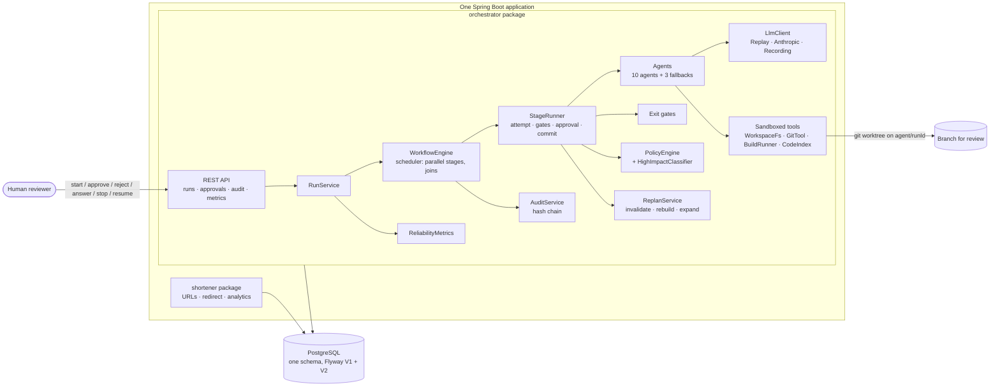
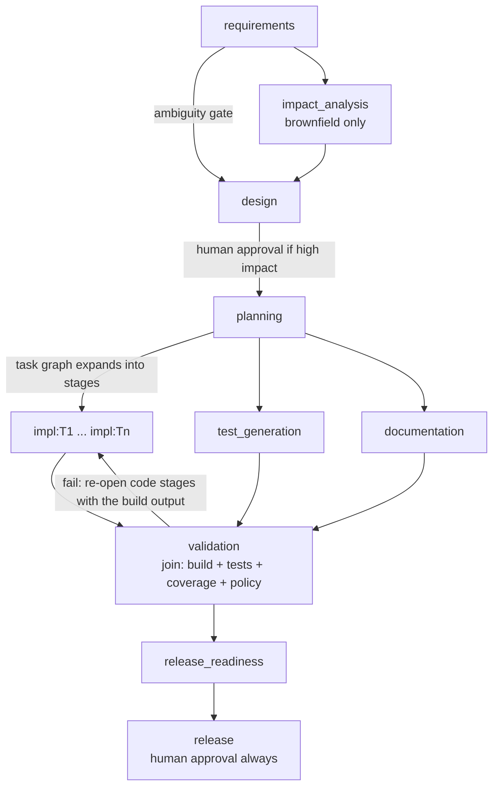
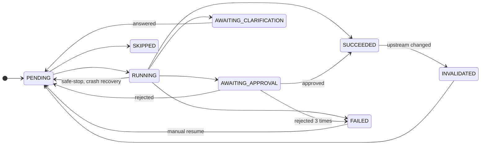

# Architecture

One Spring Boot application, one PostgreSQL database, two functionalities that never call each other:

| Package | What it is |
| --- | --- |
| `com.agentic.shortener` | The product: a URL shortener with create, redirect, delete and click analytics. It is also the codebase the orchestrator works on. |
| `com.agentic.orchestrator` | The governed agentic SDLC engine. It turns a requirement into a reviewable branch of code, tests and docs, with gates, policies, human approvals, rollback and an audit trail. |

An ArchUnit test (`ArchitectureTest`) fails the build if either package depends on the other. The orchestrator never calls the
shortener at runtime. It works on a **git worktree** (a separate checkout on its own branch) of this repository's source,
builds and tests that copy, and leaves a branch for a human to review. It never merges or pushes.

## 1. Components

## 2. The orchestration model

### The workflow is an explicit dependency graph

`workflows/sdlc.yaml` declares stages, what each depends on, its exit gates, retry policy, fallback agent and autonomy level.
It is validated at startup (unique keys, known dependencies, **no cycles**, checked with Kahn's algorithm) and every agent and
gate it names must exist, or the application does not start.

- **Sequential, parallel and join.** `impl:*`, `test_generation` and `documentation` run concurrently (up to
  `orchestrator.parallelism`); `validation` waits for all of them. The scheduler starts a stage as soon as everything it depends on
  is SUCCEEDED or SKIPPED.
- **Conditional.** `impact_analysis` runs only when the requirement is a BROWNFIELD change; otherwise it is SKIPPED, which
  counts as satisfied for its dependents.
- **Dynamic.** When `planning` is accepted, its task graph becomes one `impl:<task>` stage per task (with the tasks' own
  dependencies), and `validation` is pointed at all of them.
- **Non-linear and stateful.** A stage can be re-opened by a validation failure, a rejection, a clarification, a human
  revision, a changed upstream output or a manual rollback. Every transition is persisted, so the run survives a restart.

### State machines

Both are explicit transition tables, checked pair by pair in `StateMachineTest`; an illegal transition throws.

Runs: `CREATED -> RUNNING <-> PAUSED`, and `RUNNING -> COMPLETED | FAILED | STOPPED`; `STOPPED` and `FAILED` can be resumed.
`PAUSED` means "nothing can run until a human acts".

### One attempt of a stage (`StageRunner`)

1. **Entry gates**: every dependency is satisfied and has an accepted output; the token budget remains.
2. **Agent** runs (outside every lock, so parallel stages really overlap).
3. **Exit gates** run in order: `schema`, then the stage's others. Failures, with their messages, are fed to the next attempt.
4. **Policy** (as part of the `patch-policy` gate) scans the patch **before anything is written**.
5. **Approval**: a deterministic classifier decides whether a human must decide (see below). If so the output is parked in the
   database, *not applied*, and the stage waits.
6. **Accept**: store the artifact, apply the patch to the worktree and commit a checkpoint, mark the stage SUCCEEDED, then
   re-plan downstream if the output changed.

Failure handling is bounded: retry with backoff and jitter up to `max-attempts`, then the stage's **fallback agent**
(LLM docs writer -> template writer; LLM impact analysis -> static code index; LLM release summary -> templated), then the stage
FAILS and the run fails. A failed `validation` instead re-opens the code stages (see below).

### Gates

| Gate | Checks |
| --- | --- |
| entry | dependencies satisfied and have output; token budget remains |
| `schema` | the output parses into its typed record and satisfies required-field and structure rules (task graph acyclic, ids unique, files listed, ...) |
| `ambiguity` | pauses for a human when the spec's ambiguity score is above the threshold; at most 2 rounds, then assumptions are accepted and recorded |
| `design-scope` | work may only touch files the approved design lists (tests under the shortener test tree are always allowed) |
| `patch-policy` | every security, compliance and change-control rule (below) |
| `doc-sections` | documentation stays in `docs/` and the README and has section headings |
| `build` | compiles, all tests pass, line coverage >= 80%, no policy findings (including "every changed class has a test") |

### Human approval and controlled autonomy

Each stage is `AUTONOMOUS`, `APPROVE_ON_HIGH_IMPACT` or `ALWAYS_APPROVE`. For the middle one, `HighImpactClassifier` (plain code,
never the LLM) flags: a new Flyway migration, a changed public endpoint, a security-relevant file, a changed dependency,
deleted files, a large diff. `release` is always approved by a human.

An approval or a rejection needs a **comment**. A rejection becomes a constraint in the next attempt's prompt and re-opens the
stage (at most 3 rejections). Every decision is recorded with its actor in the decision log and the audit trail. The human
endpoints require the `X-Approval-Key` header; the safe-stop endpoint does not (stopping is always allowed).

### Policy guardrails

| Category | Rules | Enforcement |
| --- | --- | --- |
| Security | no secrets (patterns + entropy next to secret-like names); no `Runtime.exec`/`ProcessBuilder`/`System.exit`; no SQL built by concatenation; new dependencies only from an allowlist | blocks the patch |
| Compliance | no raw IPs or similar identifiers stored (hashes only) | blocks the patch |
| Change control | Flyway migrations are append-only; the orchestrator, its policies, workflows and scenarios are protected paths; size limits; every changed production class needs a test | blocks the patch |
| Agent sandbox | file tools confined to the worktree (no `..`, no absolute paths, no symlink escape, no `.git`); git limited to an allowlist (no push, fetch, merge, checkout); no generic "exec" exists | hard deny |
| Prompt injection | repository files and reviewer comments are quoted as data in prompts; and, whatever the model "decides", every tool call and patch is re-checked by the rules above | structural |

### Rollback and re-planning

- **Each accepted patch is stored** as an artifact and committed to the worktree as a checkpoint.
- **Rollback rebuilds the workspace** from the baseline commit by replaying the stored patches of only the stages that are
  staying. Unaffected stages are neither undone nor re-run, whatever order they committed in. A retained patch that no longer
  applies (it relied on code that is going away) pulls its own stage into the affected set.
- **Re-planning by input hash.** Every stage records a hash of each input. When an upstream output changes, only dependents whose
  recorded hashes no longer match are re-opened; a regenerated but identical output re-opens nothing. A dynamic stage hashes its
  own task rather than the whole plan, so editing one task leaves the others alone. Removed tasks are retired, new ones added,
  and `validation` is re-pointed at the current set.
- **Validation loop.** A failing build re-opens the stages whose files the failure names (plus, if only test files are named,
  every implementation stage, since the fault may be in any), with the failing assertion and the production stack frame as
  feedback. It is bounded: after `max-attempts` validations the run fails.
- **Safe-stop.** Manual, or automatic when the token budget is exceeded, policy violations pile up, or the model fails 5 times
  in a row. In-flight stages finish, nothing new starts, state stays resumable; resuming a budget stop needs a larger budget.
- **Crash recovery.** On startup, stages left RUNNING go back to PENDING (their work is lost, not guessed) and the run continues.

## 3. Context, lineage and audit

- **Cross-stage context**: accepted outputs are versioned, sha256-hashed artifacts in `artifact`; each agent receives only what
  it declares (the spec, the design, its task, current file contents), through `ArtifactResolver`.
- **Decision lineage**: `decision` records what was decided, by whom (agent, orchestrator or a named human), why, and the
  input hashes it was based on. `GET /api/v1/runs/{id}/decisions`.
- **Audit**: `audit_event` is append-only and **hash-chained** (`hash = sha256(prev_hash | fields)`), appended under a PostgreSQL
  advisory lock. `GET /api/v1/audit/verify` recomputes the chain and reports the first broken event if a row was edited or removed.
- **Reliability metrics** (`GET /api/v1/metrics/reliability`), computed from the persisted data: run and per-stage success rate,
  retry / fallback / rollback / fix-loop counts, MTTR (first failed attempt to eventual success, per stage), end-to-end and
  per-stage latency (average, p50, p95), approval wait, policy violations by rule, tokens used.
- Logs carry `runId` and `stageKey`, so one run can be followed end to end.

## 4. The model layer

`LlmClient` is a port with three adapters: **Replay** (default; serves `scenarios/<name>/responses/<stage>[.<n>].json`, keyed by
the stage and how many times it has been started, and applies injected faults), **Anthropic** (the official Java SDK, a timeout on
every call; refusals and truncation become retryable failures), and **Recording** (live plus saving the responses, so a live run
can be turned into a replayable scenario). Select with `orchestrator.llm.mode` = `replay | live | record`.

Replay is what makes the demo and the end-to-end tests deterministic and runnable without an API key. It proves the orchestration,
not the model's quality; see `FINAL_SUMMARY.md`.

## 5. Data model

`V1__shortener.sql`: `urls`, `click_events` (client IPs only as salted SHA-256 hashes).
`V2__orchestrator.sql`: `workflow_run`, `stage_execution`, `artifact`, `decision`, `approval_request`, `clarification`,
`audit_event`. Plain JDBC (`OrchestratorStore`) keeps every state change explicit; the shortener uses Spring Data JPA.

## 6. Key decisions

| # | Decision | Why | Trade-off |
| --- | --- | --- | --- |
| 001 | A small in-process DAG engine with state in PostgreSQL, not Temporal/Camunda | The orchestration logic is what is being demonstrated; no extra infrastructure to run | Less battle-tested, so it has exhaustive state-machine and control-path tests |
| 002 | Deterministic components decide (classifier, policies, gates, validator, release verdict); the LLM only proposes | Autonomy is bounded by construction, not by trusting prompts | Less agent freedom, more predictability |
| 003 | One monolithic app, two packages, boundary enforced by ArchUnit | Simplest to build, run and review | Agents need a protected-path rule so the engine cannot edit itself |
| 004 | A git worktree is the unit of isolation | A real branch a human can review and merge | Needs a committed baseline; Git only |
| 005 | Record/replay model | Reproducible demos and tests | Replay does not prove model quality |
| 006 | Random Base62 codes with a unique constraint (retry on collision) | Codes are not enumerable | A rare extra round trip |
| 007 | Click recording is asynchronous and lossy | A slow database never slows a redirect | Clicks can be dropped under overload (counted in `shortener.clicks.dropped`) |
| 008 | Rollback rebuilds the workspace by replaying retained patches | Minimal recompute without git-history gymnastics | History of the branch is rewritten before review |
| 009 | Model responses are keyed by "start number", not input hash | A stage redone after a re-plan gets a fresh response; recordings survive prompt edits | Hand-maintained recordings need a name per start |

## 7. Where this differs from `PLAN.md`

The plan was written first; building showed where simpler or better choices existed.

| Plan | As built | Why |
| --- | --- | --- |
| Spring Boot 4.0.x | 4.1.1 | The 4.1.1 artifacts were already available offline |
| JSON-Schema exit gates | typed records plus explicit rules (`SchemaGate`) | One less dependency, and the rules (acyclic graph, unique ids) are not expressible in a schema anyway |
| Resilience4j circuit breaker | bounded retries, timeouts, and a safe-stop after 5 consecutive model failures | Same protection, less machinery |
| Rollback by resetting to a checkpoint | rollback by replaying retained patches | Resetting also discards unrelated stages that committed later; this keeps recompute minimal |
| Replay keyed by input hash | keyed by (stage, start number) | See decision 009 |
| `READY` stored as a state | computed | A stage is ready when its dependencies are satisfied; storing it adds nothing |
| Second scripted re-plan by editing the spec mid-run | the API and engine support it (`PUT /requirement`, `/revise`) and it is tested (`ControlPathsTest`), but no scenario scripts it | The ambiguous scenario already shows two re-plans (clarification, rejection) |
| Dashboard page, OpenTelemetry | not built | Out of scope for a 24-hour prototype; Swagger UI and the audit API cover the demo |
