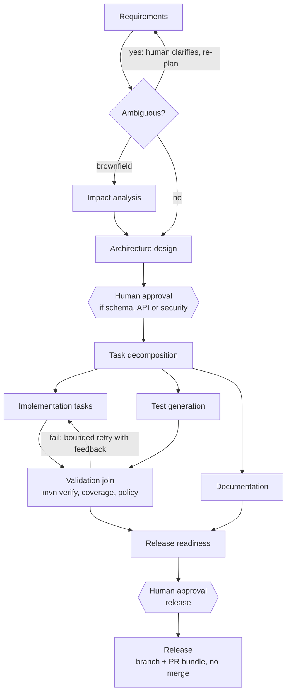

# Agentic URL Shortener — Implementation Plan

> This is the plan the build started from. Building changed a few details (Spring Boot 4.1.1, typed validation instead of
> JSON Schema, rollback by replaying patches, and others); [ARCHITECTURE.md](ARCHITECTURE.md) section 7 lists every difference
> and why. For what was actually built, read ARCHITECTURE.md and [FINAL_SUMMARY.md](FINAL_SUMMARY.md).

Build one Spring Boot application on PostgreSQL with two functionalities: a URL shortener (the target codebase) and a governed agentic SDLC orchestrator that drives requirements through release against it. Scope is kept to what the assessment asks for; the orchestrator carries most of the evaluation weight.

**Stack:** Java 25 (LTS target, built with the installed JDK 26) · Spring Boot 4.0.x · PostgreSQL 18 · Maven · Flyway · Anthropic Claude (pluggable, with offline replay)

---

## 1. Reading the assignment

| Functionality | Role | Evaluation weight |
|---|---|---|
| URL Shortener | Target codebase: runnable product with core APIs, analytics, reliability | Output realism and code quality |
| Agentic SDLC Orchestrator | Drives requirements → design → implementation → test → docs → release readiness against the shortener, with governance | Critical differentiator: most of the grade |

### Requirements traceability

| Assignment requirement | Implemented by |
|---|---|
| 4.1 Requirement understanding | RequirementsAgent → RequirementSpec with ambiguities[] and an ambiguity score; CLARIFICATION gate |
| 4.2 Task decomposition | PlannerAgent emits a TaskGraph that the engine expands into the DAG at runtime |
| 4.3 Codebase reasoning | ImpactAnalysisAgent: JavaParser + Flyway/OpenAPI scan builds a module/API/table map; the LLM reasons over it |
| 4.4 Workflow orchestration | `orchestrator` package: DAG, gates, parallel joins, lineage, approvals, retries, rollback, safe-stop, policies, audit, metrics, re-planning |
| 4.5 Engineering output | Agents write code, migrations, OpenAPI, tests and docs into a git worktree; `mvn verify` validates |
| 4.6 Validation and risk | Exit gates, policy rules, risk register |
| 4.7 Controlled autonomy | Autonomy level per stage; mandatory human approval for high-impact actions |
| 4.8 Final summary | ReleaseReadinessAgent writes ENGINEERING_SUMMARY.md per run; FINAL_SUMMARY.md for submission |

### Ambiguities and decisions

| Ambiguity | Decision | Why |
|---|---|---|
| Must a real LLM be used? | Claude via an LlmClient port, plus record/replay mode | Runs with no API key; LLM variance can't break the demo |
| What is "release"? | Branch `agent/<runId>` + PR-ready summary; never merges or pushes | A merge is the highest-impact action; a human owns it |
| One app or several? | One monolithic Spring Boot app with two packages: `shortener` and `orchestrator` | Simplest to build, run and review |
| UI needed? | No. REST API + Swagger UI | Enough to demo approvals |
| Build or buy the workflow engine? | Small in-process DAG engine with state in Postgres (ADR-001) | The orchestration logic is what is graded; no extra infra |
| Docker available? | Not on this machine. Use the local PostgreSQL 18 for the app and the tests | Nothing extra to install |

---

## 2. Architecture

One Spring Boot app, one PostgreSQL database, one Flyway history. The `shortener` and `orchestrator` packages never call each other: the orchestrator works only on a git worktree copy of this repo's source, and an ArchUnit test enforces that boundary. Agents may edit only shortener code, migrations and docs; orchestrator code is a protected path, so the engine can't modify itself.

| Layer | Choice |
|---|---|
| Language | Java 25 (LTS target), built with the installed JDK 26 |
| Framework | Spring Boot 4.0.x, single module |
| Database | PostgreSQL 18, Flyway, Spring Data JPA |
| Build | Maven, JaCoCo |
| LLM | Anthropic Java SDK behind an LlmClient port; Replay and Stub adapters |
| Supporting | Caffeine (cache), springdoc (OpenAPI), Actuator + Micrometer (metrics) |
| Tests | JUnit 5, AssertJ, MockMvc, ArchUnit, against the local Postgres |

```
agentic-url-shortener/
├── pom.xml
├── src/main/java/com/example/app/
│   ├── Application.java
│   ├── shortener/       # URL APIs, redirect, analytics
│   └── orchestrator/
│       ├── api/         # runs, approvals, audit, metrics endpoints
│       ├── engine/      # DAG scheduler, state machines, re-planning, safe-stop
│       ├── gate/        # entry / exit gates
│       ├── policy/      # policy rules + diff scanners
│       ├── approval/    # approvals + high-impact classifier
│       ├── agent/       # one class per agent
│       ├── llm/         # Anthropic, Replay, Stub clients
│       ├── tool/        # sandboxed file, git, build, code-index tools
│       └── audit/       # hash-chained audit log + reliability metrics
├── src/main/resources/
│   ├── application.yml
│   ├── db/migration/    # V1__shortener.sql, V2__orchestrator.sql
│   ├── workflows/sdlc.yaml
│   └── policies/default-policy.yaml
├── src/test/java/...
├── scenarios/           # 3 scenario files + recorded LLM responses
└── docs/
```

---

## 3. URL Shortener

A small, production-shaped service: create, redirect, manage and analyse short links, with redirect latency protected over analytics completeness.

### API (`/api/v1`, OpenAPI via springdoc, errors as RFC 9457 problem+json)

| Method | Path | Purpose |
|---|---|---|
| POST | `/api/v1/urls` | Create. Body `{url, customAlias?, expiresAt?}`; `Idempotency-Key` header → 201 + Location |
| GET | `/{code}` | Redirect 302 (so every click counts); 404 unknown; 410 expired or deleted |
| GET | `/api/v1/urls/{code}` | Metadata |
| DELETE | `/api/v1/urls/{code}` | Soft delete |
| GET | `/api/v1/urls/{code}/stats?from&to` | Total clicks, clicks per day, top referrers |
| GET | `/actuator/health`, `/actuator/prometheus` | Ops |

### Data model (Flyway `V1__shortener.sql`)

```sql
urls(id BIGSERIAL PK, short_code VARCHAR(16) UNIQUE NOT NULL, original_url TEXT NOT NULL,
     created_at TIMESTAMPTZ NOT NULL, expires_at TIMESTAMPTZ, deleted_at TIMESTAMPTZ,
     idempotency_key VARCHAR(64) UNIQUE)
click_events(id BIGSERIAL PK, url_id BIGINT FK, occurred_at TIMESTAMPTZ NOT NULL,
     referrer_host VARCHAR(255), user_agent VARCHAR(255), ip_hash CHAR(64))  -- never raw IPs
     INDEX (url_id, occurred_at)
```

### Design decisions

- **Codes:** 7-char random Base62 from SecureRandom. The UNIQUE constraint is the source of truth, with 3 retries on collision. Codes are not enumerable.
- **Redirect hot path:** Caffeine cache of code → (url, expiresAt, deletedAt). Expiry is checked after the lookup; deletes evict.
- **Analytics off the hot path:** clicks are saved with Spring `@Async` on a small bounded executor; if it is full, the click is dropped and counted. Stats are computed with SQL `GROUP BY` on `click_events`, so no rollup table is needed.
- **Safety:** only http/https, max 2048 chars, own host rejected; aliases checked against a regex and reserved words (`api`, `actuator`, …).
- **Reliability:** a simple in-memory per-IP rate limit on create, an optional `Idempotency-Key` on create, and a readiness check tied to the DB.
- **Seeded brownfield defect (documented):** the baseline ships with "expired links still redirect while cached". The brownfield scenario must find and fix it.

---

## 4. Agentic SDLC Orchestrator

An in-process DAG engine with state in Postgres, where LLM agents propose and deterministic components (gates, policies, classifier, validator) decide. Every transition is persisted, audited and resumable.

### Core concepts

| Concept | Description |
|---|---|
| WorkflowTemplate | YAML DAG of stages: agent, dependsOn, entry/exit gates, retry policy, fallback agent, autonomy level |
| WorkflowRun | One requirement's execution; carries the run context and a budget (tokens, time) |
| StageExecution | One attempt of a stage: status, attempt #, input artifact hashes, outputs, timings, error |
| Artifact | Versioned, sha256-hashed output: RequirementSpec, DesignDoc, TaskGraph, Patch, TestReport, Docs, Summary |
| Decision | Lineage record: what, who (agent or human), why, input hashes |
| ApprovalRequest | Pending human checkpoint with a diff or summary and a risk class |
| AuditEvent | Append-only, hash-chained (prev_hash, hash) for tamper evidence |

### The SDLC DAG



The graph shows sequential flow, parallel fan-out with a join before validation, a conditional stage (impact analysis for brownfield only), bounded loops (clarification, validate → fix) and dynamic expansion (the planner's TaskGraph becomes real stages).

### Engine mechanics

- **Scheduler:** a stage is READY when all dependencies are SUCCEEDED or SKIPPED and its entry gate passes. Ready stages run in parallel on a small thread pool.
- **Persistence:** every state change is saved to Postgres together with its audit event in one transaction. On restart, runs left RUNNING resume: interrupted stages are retried.
- **Stage states:** PENDING → READY → RUNNING → SUCCEEDED / FAILED / AWAITING_APPROVAL / SKIPPED / INVALIDATED, enforced by one transition table with a unit test.
- **Run states:** RUNNING ↔ PAUSED → COMPLETED / FAILED / STOPPED.

### Gates

| Type | Checks |
|---|---|
| Entry | Upstream artifacts exist and are approved; implementation touches only paths in the approved design; budget remains |
| Exit | Output matches its JSON Schema; compiles; tests pass; line coverage ≥ 80 %; no policy violations; required doc sections present |

### Retries, fallback, rollback, safe-stop

- **Bounded retries:** per-stage maxAttempts with backoff; gate failures (compiler errors, failing tests) feed the next attempt's prompt.
- **Fallback:** after retries, a declared fallback runs (LLM doc writer → template generator; LLM impact analysis → static-only report).
- **Rollback:** the workspace is a git worktree on `agent/<runId>`; each successful stage commits a checkpoint. Stage rollback resets to the previous checkpoint and invalidates downstream stages.
- **Safe-stop:** a per-run endpoint plus automatic triggers (budget exceeded, repeated policy violations, repeated LLM failures). Nothing new is scheduled; the run can be resumed.

### Human approvals and controlled autonomy

Each stage is AUTONOMOUS, APPROVE_ON_HIGH_IMPACT or ALWAYS_APPROVE. A deterministic HighImpactClassifier flags:

- New Flyway migrations (schema change)
- Public API changes (OpenAPI diff)
- Security-relevant files
- New or upgraded dependencies
- File deletions or diffs over the size threshold
- Release

Approve/reject requires a comment. A rejection becomes a constraint and re-plans the stage; every approval is an audited Decision.

### Policy guardrails (`policies/default-policy.yaml`)

| Category | Rules | Enforcement |
|---|---|---|
| Security | No secrets in diffs; no Runtime.exec/ProcessBuilder; no SQL concatenation; dependency allowlist | Exit gate → block |
| Compliance | No raw IP or PII persisted; audit required | Exit gate → block |
| Change control | Flyway migrations append-only; orchestrator package is protected; max files/LOC per task; tests for every changed class | Gates → block or approval |
| Agent sandbox | File tools confined to the worktree; command allowlist with timeouts | Tool layer → hard deny |
| Prompt injection | Repo content passed as quoted data; every tool call re-validated by policy | Tool layer |

### Context, lineage and re-planning

- **Run context** holds artifacts by reference and hash, the decision log, clarifications and constraints. Each agent gets only its declared inputs.
- **Lineage:** each StageExecution records its input hashes; `GET /runs/{id}/decisions` returns the decision log.
- **Re-planning**, when an upstream artifact gets a new version:
  1. Compute the downstream stages of the changed one.
  2. Mark stages whose input hashes no longer match INVALIDATED; leave the rest.
  3. Roll the worktree back to the last valid checkpoint.
  4. Diff old and new TaskGraphs and add, remove or modify stages.
  5. Re-require approvals whose basis changed.
  6. Record a REPLANNED decision with the reason.

### Observability and reliability metrics

- Hash-chained `audit_event` table; `GET /audit/verify` recomputes the chain.
- Logs carry runId and stageId (MDC), so one run can be followed end to end.
- `/api/v1/metrics/reliability`, computed with SQL over the run tables: success rate, retry, fallback and rollback counts, MTTR (first failure → eventual success), end-to-end and per-stage latency.

### Agents

| Agent | Kind | Output (schema-validated) |
|---|---|---|
| RequirementsAgent | LLM | RequirementSpec: goals, requirements, acceptance criteria, ambiguities, assumptions, ambiguity score |
| ImpactAnalysisAgent | Static index + LLM | ImpactReport: classes, endpoints, tables, data flows, risk |
| ArchitectAgent | LLM | DesignDoc + intended file list |
| PlannerAgent | LLM | TaskGraph: tasks with files, dependsOn, acceptance |
| CoderAgent | LLM + tools | Patch, committed in the worktree |
| TestAgent | LLM + tools | Test sources |
| DocAgent | LLM, template fallback | README / OpenAPI / CHANGELOG updates |
| ValidationAgent | Deterministic | TestReport: test results, coverage, policy scan |
| ReleaseReadinessAgent | LLM + checklist | ENGINEERING_SUMMARY.md, risks, go/no-go |

**LLM integration:** AnthropicLlmClient (official Java SDK, structured JSON output), ReplayLlmClient (keyed by agent + prompt version + input hash, loads `scenarios/recordings`), StubLlmClient for unit tests, a record mode, and a timeout on every call.

### API (selection)

```
POST /api/v1/runs                       {requirement, scenarioType?} → runId
GET  /api/v1/runs/{id}                  status + DAG with stage states
GET  /api/v1/runs/{id}/artifacts
GET  /api/v1/runs/{id}/decisions        decision log / lineage
POST /api/v1/runs/{id}/clarifications   {answers} → re-plan
POST /api/v1/runs/{id}/stop | /resume
GET  /api/v1/approvals?status=PENDING
POST /api/v1/approvals/{id}/approve|reject   {comment}
GET  /api/v1/metrics/reliability
GET  /api/v1/audit?runId=   ·   GET /api/v1/audit/verify
```

**Tables (`V2__orchestrator.sql`, same database):** workflow_run, stage_execution, artifact, decision, approval_request, audit_event.

---

## 5. The three scenarios

Each scenario is a scripted orchestrator run against the shortener that exercises a different set of controls, with one injected fault each.

| | Greenfield | Brownfield | Ambiguous |
|---|---|---|---|
| Requirement | "Add `GET /api/v1/urls/{code}/qr` returning PNG/SVG with size options" | "Expired links still redirect sometimes. Fix it, and add bulk creation of up to 100 URLs." | "Make the shortener safer against abuse." |
| Demonstrates | Full DAG; parallel impl/test/docs + join; new dependency (ZXing) → dependency approval | ImpactAnalysis finds the cache/expiry bug; new migration → schema approval; first validation fails → feedback retry; regression test proves the fix | Ambiguity over threshold → clarification pause; human answers some, approves assumptions for the rest → re-plan; a task rejected at approval → feedback loop |
| Injected fault | LLM timeout on DocAgent → retry → template fallback | Agent tries to edit `V1__shortener.sql` → policy block → re-attempt | Budget exhausted → safe-stop → human raises budget → resume |
| Output | Branch `agent/<id>`, green build, ENGINEERING_SUMMARY.md | Same + impact report | Same + clarification log and re-plan decisions |

Scenarios live in `scenarios/<name>.yaml` (requirement, fault toggles, expected outcomes) and run with `scripts/run-scenario.ps1 <name> [--live]`; replay is the default. `docs/SCENARIOS.md` records each run's decomposition, decisions, approvals, metrics and validation results.

---

## 6. Testing approach

Quality bar: ≥ 80 % line coverage (JaCoCo), and all tests run against the local Postgres with `mvn verify`.

| Level | Shortener | Orchestrator |
|---|---|---|
| Unit | Code generator, validators, service rules | State transition table, readiness, every gate and policy rule, HighImpactClassifier, hash chain, re-plan diffing |
| Web | MockMvc controller tests | Run and approval controllers |
| Integration | Create → redirect → stats | Full run with Stub/Replay LLM; restart-and-resume; parallel join |
| Fault injection | Full executor drops clicks, not redirects | LLM timeout → retry → fallback; policy block; budget safe-stop; validation failure → rollback; rejection → re-plan |
| Security | Malicious URLs, alias injection, rate limit | Path traversal, command allowlist, secret scanner, protected orchestrator path |
| Architecture | ArchUnit: `shortener` and `orchestrator` don't depend on each other | (same test) |
| End-to-end | — | Three scenarios in replay |

---

## 7. Risk register

The two highest risks are LLM non-determinism and scope; replay mode and the deliberately small scope address them.

| Risk | Likelihood / impact | Mitigation |
|---|---|---|
| Non-deterministic LLM output breaks the demo | High / High | Replay by default; JSON-Schema exit gates; feedback retries; fallbacks |
| Scope too large for the time available | High / High | One app, no UI, no extra infra; only features the assessment names |
| Agent edits the orchestrator's own code | Medium / High | Orchestrator package is a protected path (hard deny); agents work only in a worktree copy |
| Agent generates harmful or wrong code | Medium / High | Worktree sandbox, policy gates, mandatory `mvn verify`, human release approval, never merges |
| Prompt injection via repo content | Medium / High | Content as data; policy re-validates tool calls; command allowlist |
| Runaway tokens or cost | Medium / Medium | Per-run budget and safe-stop |
| Analytics loss under load | Medium / Low | Accepted trade-off; dropped clicks are counted |

---

## 8. Key decisions, assumptions and limitations

The central decision is ADR-002: deterministic components own every safety decision, so autonomy is controlled by construction.

| ADR | Decision | Trade-off |
|---|---|---|
| 001 | Small in-process DAG engine with state in Postgres, not Temporal/Camunda | Transparent and infra-free, but less battle-tested → state-machine tests |
| 002 | Deterministic classifier, policies and validator decide; LLMs only propose | Less agent freedom, more predictability |
| 003 | One monolithic app with two packages, boundary enforced by ArchUnit | Simple to build and run; agents need a protected-path rule |
| 004 | Git worktree as the unit of isolation and rollback | Simple checkpoints; Git-only |
| 005 | Record/replay LLM | Reproducible demos; replay doesn't prove LLM quality |
| 006 | Random Base62 codes with a unique constraint | Non-enumerable; rare extra round-trip |
| 007 | Async, lossy click recording | Fast redirects; possible click loss under load |

**Assumptions and limitations**

- Single-tenant; no end-user auth (an API key protects the approval endpoints only).
- Runs as a single instance; not built for horizontal scaling.
- The orchestrator targets this repo's shortener code only, not arbitrary repos.
- Release stops at a PR-ready branch; no deployment.
- Replay proves orchestration behaviour; one committed live run per scenario is the evidence of LLM quality.

---

## 9. Next steps

- [ ] Confirm stack: Spring Boot 4.0.x on Java 25, and an Anthropic API key for one live recording pass
- [ ] Scaffold the single Spring Boot app on `feature/scaffold` off `develop`
- [ ] Build the shortener package first, then the orchestrator package
